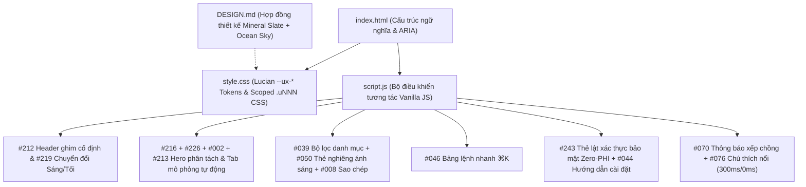

# Extension Hub — Architecture Map

## Overview

`extension-hub` là trang cổng thông tin tĩnh (Static Landing Portal) giới thiệu, tra cứu lệnh nhanh (`⌘K`) và cung cấp đường dẫn cài đặt chính thức trên Chrome Web Store cho 3 tiện ích máy tính của Trung Anh: **Điều dưỡng VNPT HIS**, **HIS CamSync** và **Aladinn**. Giao diện được xây dựng thuần HTML/CSS/Vanilla JS dựa trên hệ thống token và chuyển động tương tác của **Lucian UX/UI** kết hợp chuẩn **DESIGN.md** (Mineral Slate + Ocean Sky, không phụ thuộc thư viện nặng bên ngoài, tương thích tức thì với Vercel Static Hosting).

## Architecture Diagram

## Blast Radius Matrix

| Thành phần / File | Phụ thuộc vào | Khu vực ảnh hưởng khi chỉnh sửa | Mức độ rủi ro |
| --- | --- | --- | --- |
| `DESIGN.md` | Quy chuẩn thiết kế chung | Định hướng bảng màu `--ux-*`, font chữ và độ bo góc trong `style.css` | Thấp |
| `index.html` | `style.css`, `script.js`, liên kết Chrome Web Store | Toàn bộ nội dung hiển thị, đường dẫn cài đặt 3 tiện ích và khả năng truy cập bàn phím | Trung bình |
| `style.css` | Biến CSS `:root` / `[data-theme="dark"]` | Giao diện Sáng/Tối, bố cục đáp ứng (Desktop / Tablet / Mobile 375px) và hiệu ứng chuyển động | Trung bình |
| `script.js` | Các selector `#id` và `.uNNN` trong `index.html` | Tìm kiếm `⌘K`, lọc danh mục, sao chép liên kết, lật thẻ bảo mật và chú thích nổi | Trung bình |

## Known Issues & Key Decisions (Hồ sơ Bệnh án Dự án)

- **Loại bỏ hoàn toàn mã QR cho tiện ích máy tính & ghim cố định thanh điều hướng trên cùng (2026-11):**
  - *Nguyên nhân cũ:* Thiết kế cũ dùng nền kính mờ tím và đặt mã QR cho liên kết Chrome Web Store — không hợp lý về trải nghiệm thực tế vì Chrome Extension chỉ cài đặt được trên trình duyệt máy tính (Chrome, Edge, Cốc Cốc), không cài trên điện thoại.
  - *Giải pháp dứt điểm:* Chuyển sang hệ thống token khoáng thạch trung tính (`#F4F6F9` / `#080B12`) cùng điểm nhấn xanh biển đạt chuẩn độ tương phản WCAG AA (`#0369A1` / `#38BDF8`) và 14 phần tử tương tác Lucian UX/UI. Gỡ bỏ hoàn toàn mã QR (và truy vấn ảnh bên thứ ba), thay bằng dòng thông tin trình duyệt máy tính gọn gàng kèm nút sao chép liên kết một chạm để gửi qua Zalo PC, ghim cố định thanh ngang trên cùng (`#212`), bổ sung bảng lệnh nhanh `⌘K` hỗ trợ tìm tiếng Việt không dấu (`#046`), và khóa cứng độ trễ chú thích nổi ở mức `300ms` hiện / `0ms` tắt ngay (`#076`).
